<picture>
  <source media="(max-width:600px) and (prefers-color-scheme:dark)" srcset="assets/profile/header-mobile-dark.svg">
  <source media="(max-width:600px)" srcset="assets/profile/header-mobile-light.svg">
  <source media="(prefers-color-scheme:dark)" srcset="assets/profile/header-dark.svg">
  
</picture>

<picture>
  <source media="(max-width:600px)" srcset="assets/profile/sections/intro-mobile.svg">
  
</picture>

### 

  

### 

         

### 

   

 

<picture></picture> &nbsp; <strong>Lenguajes y contribuciones</strong>

 

 

### 

<a href="mailto:personalusevictor@gmail.com">&nbsp;personalusevictor@gmail.com</a>

<a href="https://x.com/personaluvictor">&nbsp;@personaluvictor</a>
